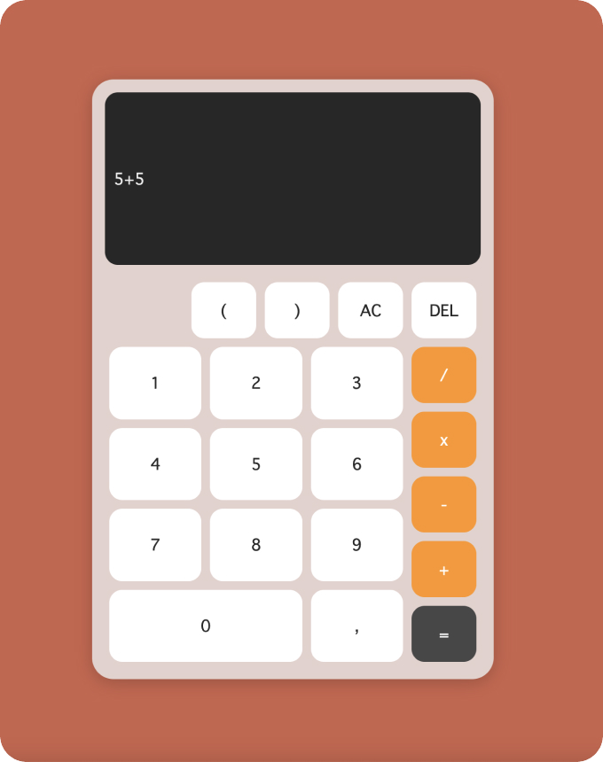

# Calculator

Static HTML calculator written while learning TypeScript. The UI is French. It uses a comma as the decimal separator and `x` for multiply.

## Use

Open `index.html` in a browser. The page loads `css/style.min.css` and `js/index.min.js`.

Source lives in `css/style.scss` and `js/index.tsx`. After editing either, run `./build.sh` (needs `bun`: it runs `sass` and `esbuild` through `bunx`) and commit the regenerated `.min` files. Never edit them by hand.

## License

MIT. See `LICENSE`.
